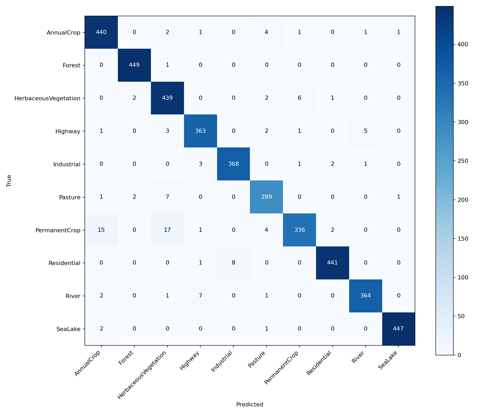

# Transfer learning на EuroSAT RGB

Классификация спутниковых снимков из [EuroSAT RGB](https://www.kaggle.com/datasets/waseemalastal/eurosat-rgb-dataset):
10 классов, ResNet18 с весами ImageNet. Нужно сравнить обучение нового классификатора и дообучение последнего блока на одной тестовой выборке.

## Решение

- Стратифицированное разбиение train/val/test — 70/15/15, seed 42.
- Сначала 5 эпох обучается только `fc` с lr 0.001, затем 10 эпох — `layer4` и `fc` с lr 0.0001. Оптимизатор AdamW, batch size 64. У замороженных блоков фиксируется и BatchNorm.
- Изображения приводятся к 224×224 и нормализуются по ImageNet; для train используются случайный crop и отражения. Лучшие веса выбираются по validation, оба варианта оцениваются на общем test.
- Сохраняются метрики, веса, версия датасета, списки файлов и SHA256, гиперпараметры, версии библиотек и снимок исходников.

## Локальный запуск на CUDA

Требуются Python 3.11+, видеокарта NVIDIA и совместимый драйвер. Команды выполнять из корня репозитория. Сначала создать отдельное окружение:

```bash
python -m venv .venv-cuda
```

Активировать его: `source .venv-cuda/bin/activate` в Linux/WSL или `.\.venv-cuda\Scripts\Activate.ps1` в Windows PowerShell.

Установить CUDA-сборку PyTorch, затем остальные зависимости. Ниже пример для CUDA 12.8; другие сборки для этих версий указаны в [инструкции PyTorch](https://pytorch.org/get-started/previous-versions/#v2100).

```bash
python -m pip install torch==2.10.0 torchvision==0.25.0 --index-url https://download.pytorch.org/whl/cu128
python -m pip install -r tasks/transfer_learning/requirements.txt
python -c "import torch; print(torch.__version__, torch.version.cuda); assert torch.cuda.is_available(), 'CUDA unavailable'; print(torch.cuda.get_device_name(0))"
```

Скачать нужную версию EuroSAT RGB со страницы датасета и распаковать, например, в `data/EuroSAT_RGB/`. Этот каталог должен непосредственно содержать папки классов `AnnualCrop`, `Forest` и остальные. Запустить, заменив `<VERSION>` номером скачанной версии:

```bash
python -m tasks.transfer_learning.main --data-dir data/EuroSAT_RGB --output-dir tasks/transfer_learning/results/local-01 --dataset-version <VERSION> --device cuda
```

Каталог результатов должен быть новым или пустым. При первом запуске нужен Internet для загрузки весов ImageNet. При нехватке видеопамяти уменьшить `--batch-size`, например до 16. Остальные параметры: `python -m tasks.transfer_learning.main --help`. Ноутбук и доставка исходников в удалённую сессию для локального запуска не нужны.

## Запуск из VS Code в Colab

Используется расширение [Google Colab](https://github.com/googlecolab/colab-vscode).
Подготовка окружения и запуск находятся в [colab.ipynb](./colab.ipynb), весь код обучения — в `.py`.

1. Открыть [colab.ipynb](./colab.ipynb) и выбрать **Select Kernel → Colab → существующий сервер с T4**. Если сервера ещё нет — создать через **New Colab Server**, выбрав GPU. Первая ячейка `nvidia-smi` проверяет наличие видеокарты; у текущей T4 около 15 ГБ памяти.
2. Подготовить снимок исходников **в локальном терминале из корня репозитория**:

   ```bash
   python -m tasks.transfer_learning.snapshot --output tasks/transfer_learning/source-upload.zip
   ```

3. Через браузер загрузить `data/eurosat_rgb.zip` в папку `cv-practice` на Google Drive. Выполнить ячейку `drive.mount` в ноутбуке и подтвердить доступ к Drive. В локальном Explorer VS Code выбрать только `tasks/transfer_learning/source-upload.zip`, затем **ПКМ → Upload to Colab**. Через панель **Colab → Contents** проверить путь `/content/source-upload.zip`; если он отличается, изменить `TL_SOURCE_ARCHIVE`. [Инструкция расширения](https://github.com/googlecolab/colab-vscode/wiki/User-Guide#uploading-files-to-colab-servers).
4. Выполнить ячейку с параметрами. `TL_DATA_ARCHIVE` уже указывает на `/content/drive/MyDrive/cv-practice/eurosat_rgb.zip`. Также заданы версия датасета **1**, распаковка в `/content/data/EuroSAT_RGB`, проект в `/content/cv-practice` и результаты в `/content/eurosat-run-01`. Локальная папка `data/` удалённому ядру недоступна.
5. Выполнить ячейки распаковки и подготовки зависимостей. Проверяется SHA256 архива EuroSAT, затем распаковываются данные и исходники. В Colab используются предустановленные torch и torchvision; ячейка проверяет их версии и доступность T4. Фактические версии сохраняются в результатах. [requirements.txt](./requirements.txt) с фиксированными версиями предназначен для локального запуска; в Colab его устанавливать не нужно.
6. Выполнить ячейку запуска `python -m tasks.transfer_learning.main`. Она обучит оба варианта и оценит их на общем test. Для нового эксперимента изменить `TL_OUTPUT_DIR`: существующие результаты не перезаписываются.
7. После обучения выполнить последнюю ячейку: она создаст `/content/eurosat-run-01.zip`. В **Colab → Contents** обновить список файлов и выбрать у архива **Download…**. Сохранить его локально до отключения сервера: содержимое `/content` временное.

Все параметры и значения по умолчанию доступны локально и в копии репозитория на Colab:

```bash
python -m tasks.transfer_learning.main --help
```

`--prepare-only` сохраняет разбиение без обучения; `--splits-dir` позволяет повторно использовать сохранённое разбиение с проверкой файлов.

## Результаты

[Сравнение вариантов](./results/eurosat-run-01/comparison.md) для выполненного эксперимента: test accuracy **93,56%** при обучении только классификатора и **97,19%** после fine-tuning (**+3,63 п.п.**), общая тестовая выборка — 4050 изображений.

Обучение выполнено в Colab на Tesla T4, EuroSAT RGB версии 1, seed 42; torch **2.14.1+cu130**, torchvision **0.29.1+cu130**.

Только классификатор:


После fine-tuning:



В каталоге результатов появятся `comparison.md` и `comparison.json` со сравнением accuracy, а в `head_only/` и `fine_tuned/` — `best.pt`, история обучения, `metrics.json`, матрицы ошибок в PNG/CSV и предсказания. Строки матрицы — истинные классы, столбцы — предсказанные. Разбиение хранится в `splits/`, параметры и окружение — в `experiment.json` и `environment.*`, исходники — в `source.zip`. `completed.json` означает успешное завершение.

В Git включены отчёт `comparison.md` и обе матрицы ошибок в PNG. Веса, архивы, JSON, TXT и CSV с полными результатами остаются локально в `tasks/transfer_learning/results/`.
